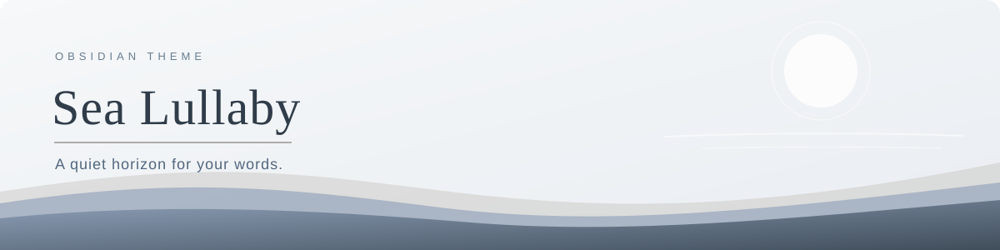
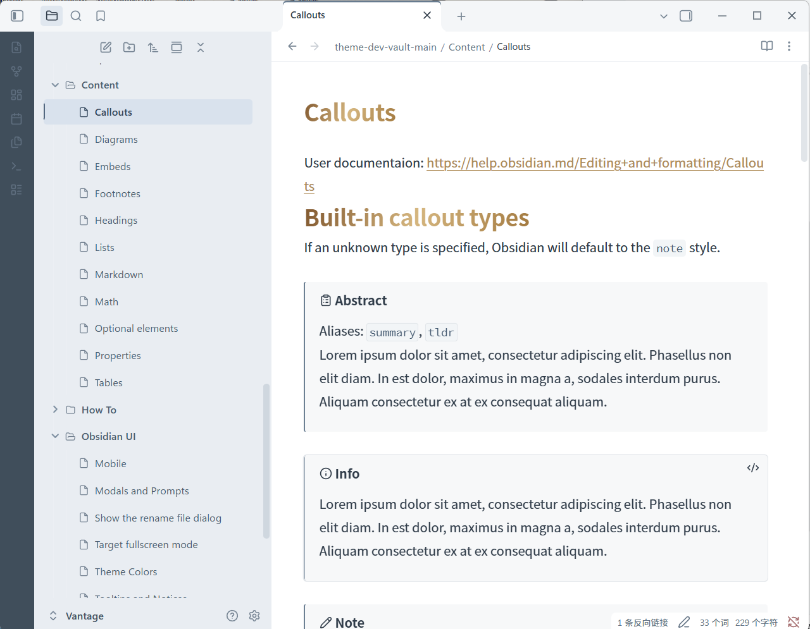

<p align="center">
  
</p>

<h1 align="center">Sea Lullaby · 海之摇篮</h1>

<p align="center">
  <strong>给文字一片安静的海岸。</strong><br>
  海蓝色导航、明亮的书写页面，以及从容的留白。
</p>

<p align="center">
  <a href="https://obsidian.md/"></a>
  <a href="manifest.json"></a>
  <a href="LICENSE"></a>
</p>

<p align="center">
  <a href="README.md">English</a> · <strong>简体中文</strong><br>
  <a href="#预览">预览</a> · <a href="#设计">设计</a> · <a href="#安装">安装</a> · <a href="#致谢与许可">致谢与许可</a>
</p>

---

**Sea Lullaby · 海之摇篮** 是一款适合安静阅读与书写的 Obsidian 主题。窄深色工具栏稳住界面，浅雾蓝侧栏围绕明亮的笔记页面；暖沙色标题、柔和的链接与舒展的行距，让注意力回到文字。

## 预览

<p align="center">
  <br>
  <sub>Sea Lullaby 在 Obsidian 中的提示块与暖沙色细节</sub>
</p>

## 设计

| 柔和的工作区 | 清晰的书写页面 | 自然融入的细节 |
| :--- | :--- | :--- |
| 浅色导航、窄深色工具栏和明确的选中状态。 | 近白色笔记、青灰色文字、适中的行宽和六级标题。 | 链接、标签、表格、引用、代码块与提示块保持统一。 |

### 配色

| 颜色 | 色值 | 用途 |
| :--- | :--- | :--- |
| **Sea · 深海** | `#404E5B` | 工具栏与界面最深色 |
| **Harbor · 港湾** | `#677B8F` | 导航与次级强调 |
| **Mist · 海雾** | `#8FA0B8` | 柔和高亮 |
| **Stone · 暖石** | `#948F8C` | 暖色平衡 |
| **Silver · 银灰** | `#CCC9C6` | 中性色细节 |
| **Sand · 暖沙** | `#AE8B56` | 链接与标题暖色强调 |
| **Paper · 纸面** | `#FFFFFF` | 笔记背景 |

主题在 Obsidian 的浅色和深色外观设置下均保持同一套浅色阅读配色。实际字体取决于系统中安装的字体。

## 安装

**需要 Obsidian 1.13.0 或更高版本。**

1. [下载此仓库](https://github.com/tail258/Sea-Lullaby/archive/refs/heads/main.zip)并解压。
2. 在笔记库中创建 `.obsidian/themes/Sea Lullaby/` 文件夹。
3. 将 `theme.css` 和 `manifest.json` 复制到该文件夹。
4. 打开 Obsidian 的**设置 → 外观**，选择 **Sea Lullaby**。如果没有立即出现，请重启 Obsidian。

```text
.obsidian/
└── themes/
    └── Sea Lullaby/
        ├── manifest.json
        └── theme.css
```

## 反馈

发现样式问题？欢迎[提交 Issue](https://github.com/tail258/Sea-Lullaby/issues)，并附上 Obsidian 版本、操作系统及受影响界面的截图。

## 致谢与许可

Sea Lullaby 基于 [Ink & Linen](https://github.com/tail258/Ink-Linen) 和 Dust & Vellum 调整。原有许可声明保留在 [LICENSE](LICENSE) 中，主题按 MIT 许可证发布。

---

<p align="center"><em>让页面呼吸，让潮声放缓。</em></p>
